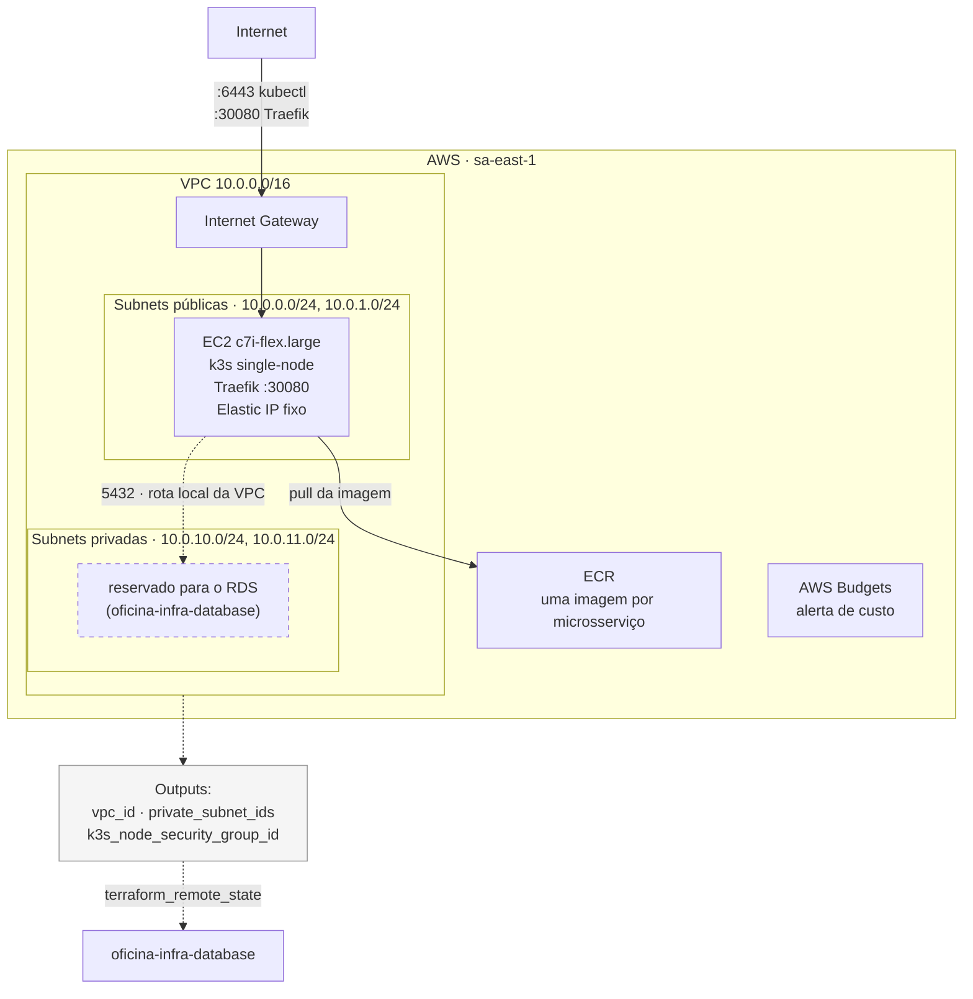

# oficina-infra-k8s

Infraestrutura de **rede e cluster Kubernetes** do sistema de gestão de oficina mecânica, provisionada com Terraform na AWS (`sa-east-1`).

Este é o **repositório base** do projeto: ele cria a VPC e o security group do nó, que os outros repositórios de infraestrutura consomem. Nada mais sobe antes dele.

> Parte do Tech Challenge SOAT — Fases 3 e 4. Repositórios irmãos:
> [`oficina-infra-database`](https://github.com/Luizustavo/oficina-infra-database) ·
> [`oficina-lambda-auth`](https://github.com/Luizustavo/oficina-lambda-auth) ·
> [`oficina-backend`](https://github.com/Luizustavo/oficina-backend) (OS Service) ·
> [`oficina-billing-service`](https://github.com/Luizustavo/oficina-billing-service) ·
> [`oficina-execution-service`](https://github.com/Luizustavo/oficina-execution-service)

---

## Deploy ativo

| Recurso | Como obter o valor atual |
|---|---|
| IP do nó k3s | `terraform output -raw k3s_instance_public_ip` |
| Entrada do cluster (Traefik) | `terraform output -raw app_url` |
| Registros de imagens (um por serviço) | `terraform output ecr_repository_urls` |

A porta de entrada pública do sistema é o API Gateway, provisionado por [`oficina-lambda-auth`](https://github.com/Luizustavo/oficina-lambda-auth): **https://dzsca8yk0b.execute-api.sa-east-1.amazonaws.com**

Swagger da aplicação: **https://dzsca8yk0b.execute-api.sa-east-1.amazonaws.com/api/docs**

> A infraestrutura é destruída ao final de cada sessão de trabalho para não consumir crédito. Enquanto estiver fora, os endereços não respondem — e alguns mudam a cada novo `apply`. O vídeo de demonstração mostra o ambiente no ar.

---

## Propósito

| Recurso | Arquivo | Descrição |
|---|---|---|
| VPC + subnets | `vpc.tf` | 1 VPC, 2 subnets públicas (nó k3s) e 2 privadas (RDS), sem NAT Gateway |
| Nó Kubernetes | `ec2.tf` | 1 EC2 `c7i-flex.large` (4 GB) rodando k3s via user-data, com Elastic IP fixo, IAM role de leitura no ECR e acesso por SSM (sem SSH) |
| Porta de entrada do cluster | `k3s-user-data.sh.tpl` | Traefik (o ingress que já vem no k3s) em NodePort `30080`, roteando por caminho para os três microsserviços |
| Registro de imagens | `ecr.tf` | Um ECR por microsserviço (`oficina-backend`, `oficina-billing-service`, `oficina-execution-service`), com lifecycle mantendo só as 10 últimas |
| Manifestos de plataforma | `k8s/platform/` | Namespaces dos serviços e, a partir da Fase 4, o RabbitMQ — aplicados pelo workflow `platform.yml` |
| Alerta de orçamento | `budget.tf` | AWS Budgets — e-mail quando o gasto do mês passa de 50% e 100% do limite |

## Arquitetura deste repositório



### Por que k3s numa EC2, e não EKS

O control plane do EKS custa US$ 0,10/hora **sempre**, sem free tier. Uma EC2 `t3.small` e o RDS `db.t4g.micro` são cobertos pelo free tier de conta nova (750h/mês, primeiros 12 meses). Trocando EKS por k3s e removendo o NAT Gateway (o nó fica em subnet pública com IP direto), o custo cai de ~US$ 0,37/hora para perto de zero.

O trade-off: k3s não tem a integração da AWS para criar Load Balancers, então o cluster é exposto via `NodePort` em `http://<ip-do-nó>:30080`. Na Fase 3 o API Gateway passou a ser a porta de entrada pública, e esse NodePort virou o backend dele.

### Fase 4: Traefik como porteiro do cluster

Com três microsserviços, uma porta só precisa atender todos. O **Traefik**, que já vem instalado no k3s, assume a porta `30080` e encaminha cada requisição pelo começo do caminho:

| Caminho | Serviço | Namespace |
|---|---|---|
| `/api/billing/*` | Billing Service | `billing` |
| `/api/execution/*` | Execution Service | `execution` |
| `/api/*` (o resto) | OS Service (`oficina-backend`) | `oficina` |

Cada serviço declara o seu caminho num `Ingress` no próprio repositório. A configuração do Traefik é escrita pelo user-data na pasta de manifestos do k3s (`/var/lib/rancher/k3s/server/manifests/`), que o k3s aplica sozinho ao subir — o cluster já nasce com a porta certa, tirada da mesma variável `k3s_node_port` que libera o security group. Decisão registrada em `ADR-015`.

O nó passou de `t3.small` (2 GB) para **`c7i-flex.large` (4 GB)** e o disco de 20 para **30 GB**: três serviços, RabbitMQ, MongoDB, Redis e o agente do New Relic não cabem em 2 GB.

Por que `c7i-flex.large`, e não `t3.medium`, que custa metade: a conta AWS do projeto está no **plano gratuito**, que só permite criar tipos de instância elegíveis ao free tier. A `t3.medium` é recusada no `RunInstances` (`InvalidParameterCombination: ... not eligible for Free Tier`). Entre os elegíveis em `sa-east-1`, a `c7i-flex.large` é o único com 4 GB (a `m7i-flex.large` tem 8 GB por ~17% a mais).

Decisão registrada em `ADR-001` (repositório `oficina-backend`).

### Fase 4: RabbitMQ, o broker de mensagens

Os três serviços conversam entre si por mensagens (a saga da `ADR-011`), e quem entrega essas mensagens é o RabbitMQ. Ele roda no namespace `messaging`, com manifestos em `k8s/platform/rabbitmq/`:

| Arquivo | O que define |
|---|---|
| `statefulset.yaml` | O broker (`rabbitmq:4.1-management`, 1 réplica, até 512 Mi de memória) e um volume de 2 Gi para as filas sobreviverem a um restart do pod |
| `service.yaml` | O endereço interno `rabbitmq.messaging.svc.cluster.local` (5672 AMQP, 15672 painel, 15692 métricas) |
| `configmap.yaml` | Limites de memória e disco, para o broker frear publicações em vez de ser morto por falta de memória, e os plugins ligados (painel, métricas e shovel) |

Ele só é acessível de dentro do cluster. Os serviços se conectam em:

```
amqp://oficina:<senha>@rabbitmq.messaging.svc.cluster.local:5672/oficina
```

O último `oficina` é o **vhost**, um "espaço" isolado dentro do broker onde ficam as exchanges e filas do projeto. Exchanges e filas **não** são criadas aqui: cada serviço declara as suas ao subir (contrato em `docs/arquitetura/contratos-de-mensagens.md`, no `oficina-backend`).

**Senha.** O usuário é `oficina`, e a senha vem do secret `RABBITMQ_PASSWORD` do Environment `production`. O workflow `platform.yml` recria o Secret `rabbitmq-credentials` a cada subida do cluster, então a senha é sempre a mesma entre sessões. Use só letras e números (`openssl rand -hex 24`), porque a senha vai dentro de uma URL. O usuário `guest` não existe.

**Painel de administração** (filas, mensagens, consumidores):

```bash
kubectl port-forward -n messaging svc/rabbitmq 15672:15672
# abra http://localhost:15672 — usuário oficina, senha do RABBITMQ_PASSWORD
```

Com o plugin de shovel ligado, uma mensagem que caiu numa fila `.dlq` pode voltar para a fila original pelo próprio painel: *Queues* → a fila `.dlq` → *Move messages*. Quando reprocessar, e como, está em `docs/arquitetura/operacao-da-mensageria.md` no `oficina-backend`.

Para ler a senha direto do cluster:

```bash
kubectl get secret rabbitmq-credentials -n messaging -o jsonpath='{.data.password}' | base64 -d; echo
```

## Tecnologias

| Camada | Tecnologia |
|---|---|
| IaC | Terraform >= 1.11 (provider AWS ~> 5.0) |
| State remoto | S3 com lock nativo (`use_lockfile`) — sem DynamoDB |
| Orquestração | k3s (Kubernetes CNCF-conformant) |
| Computação | EC2 Amazon Linux 2023 |
| Registro | Amazon ECR |
| CI/CD | GitHub Actions |
| Acesso ao nó | AWS Systems Manager Session Manager |

---

## Pré-requisitos

- Terraform >= 1.11
- AWS CLI v2 com um profile configurado (`aws configure --profile oficina-fase2`)
- Usuário IAM com permissão para VPC, EC2, ECR, IAM roles, Budgets e S3

## Passo 1 — Bootstrap do backend (uma vez por conta AWS)

O bucket que guarda o state é o único recurso criado fora do Terraform — é o problema do ovo e da galinha: o Terraform precisa do bucket para guardar o state, e criar o bucket com Terraform geraria um state sem onde morar.

```bash
./scripts/bootstrap-backend.sh
```

Cria `oficina-backend-tfstate-<account-id>` com versionamento, criptografia AES256 e bloqueio total de acesso público. É idempotente — rodar de novo não quebra nada.

## Passo 2 — Aplicar

```bash
cp terraform.tfvars.example terraform.tfvars   # ajuste se quiser
terraform init
terraform plan
terraform apply
```

Leva ~2-3 minutos. Outputs relevantes:

| Output | Para quê |
|---|---|
| `k3s_instance_public_ip` | IP fixo do nó |
| `connect_via_ssm` | Comando pronto para abrir shell no nó, sem chave SSH |
| `app_url` | Entrada do cluster (Traefik), por trás do API Gateway |
| `ecr_repository_urls` | Destino do `docker push` de cada microsserviço |
| `vpc_id`, `private_subnet_ids`, `k3s_node_security_group_id` | **Contrato consumido pelo repo do banco** |

## Passo 3 — Pegar o kubeconfig

```bash
$(terraform output -raw connect_via_ssm)     # abre shell no nó
sudo cat /etc/rancher/k3s/k3s.yaml           # copie o conteúdo
```

Na sua máquina, salve em `~/.kube/config-k3s`, troque `127.0.0.1` pelo IP público do nó e:

```bash
export KUBECONFIG=~/.kube/config-k3s
kubectl get nodes    # o nó deve aparecer como Ready
```

---

## Sobre Dockerfile

Este repositório **não tem Dockerfile, e não deveria ter**. Ele provisiona infraestrutura com Terraform; não há aplicação para empacotar aqui.

O `Dockerfile` da aplicação vive em [`oficina-backend`](https://github.com/Luizustavo/oficina-backend/blob/main/Dockerfile), e a imagem construída a partir dele é publicada no ECR que **este** repositório cria.

---

## CI/CD

Dois workflows. `.github/workflows/terraform.yml` cuida da infraestrutura AWS:

| Gatilho | O que roda |
|---|---|
| Pull Request para `main` | `fmt -check` → `init` → `validate` → `plan`, com o plan comentado no PR |
| Push em `main` | `apply` automático — é o "deploy automático da branch de produção" exigido pela Fase 3 |
| `workflow_dispatch` | `plan`, `apply` ou `destroy` sob demanda |

`.github/workflows/platform.yml` aplica `k8s/platform/` **dentro** do cluster:

| Gatilho | O que roda |
|---|---|
| Logo depois de um `apply` do Terraform na `main` | Espera o k3s terminar de instalar, cria o Secret do RabbitMQ, aplica os manifestos, espera o RabbitMQ ficar pronto e confere que o Traefik está na porta 30080 |
| Push em `main` mudando `k8s/platform/` | Idem |
| `workflow_dispatch` | Idem, sob demanda |

Se não houver nó ligado (infra destruída), o workflow termina sem erro e sem fazer nada.

O job de apply roda no Environment `production`. Ele existe mas **está sem required reviewers**, então o apply é de fato automático no merge. Para exigir aprovação humana antes de cada mudança de infraestrutura, adicione reviewers em *Settings → Environments → production* — o pipeline passa a pausar e esperar.

**Secrets necessários** em *Settings → Secrets and variables → Actions*:

| Secret | Valor |
|---|---|
| `AWS_ACCESS_KEY_ID` | Chave do usuário IAM de deploy |
| `AWS_SECRET_ACCESS_KEY` | Segredo correspondente |
| `RABBITMQ_PASSWORD` | Senha do usuário `oficina` do RabbitMQ, só letras e números (no Environment `production`) |

**Proteção da branch `main`** (*Settings → Branches → Add rule*): exigir Pull Request, exigir o job `Plan` verde e bloquear push direto.

---

## ⚠️ Ordem de destroy

A rede daqui é pré-requisito do RDS. **Destrua sempre nesta ordem:**

```
1. oficina-infra-database   (terraform destroy)
2. oficina-infra-k8s        (terraform destroy)  ← este repositório
```

Invertendo, o destroy do banco falha por dependência órfã.

Ao final de cada sessão de trabalho, confirme que nada ficou ligado:

```bash
aws ec2 describe-instances --profile oficina-fase2 \
  --filters "Name=instance-state-name,Values=running" \
  --query "Reservations[].Instances[].InstanceId"   # deve voltar vazio
```

O `budget.tf` manda e-mail se o gasto passar dos limites, mas não confie só nisso — o `destroy` é o que realmente para o custo.

## Custo aproximado

| Recurso | US$/hora | Free tier (conta nova)? |
|---|---|---|
| EC2 c7i-flex.large | ~0,13 | Não (é elegível ao free tier, mas a conta paga com créditos; precisa de 4 GB para os três microsserviços, broker e bancos) |
| EBS 30GB + tráfego | ~0,004 | Parcialmente |
| ECR, VPC, subnets, SGs | 0 | Sim |
| **Total** | **~US$ 0,14/hora** (sem o RDS) | |

## API

Este repositório não expõe API. Cada microsserviço documenta a própria API com Swagger: `/api/docs` (OS Service), `/api/billing/docs` e `/api/execution/docs`, todos atrás do API Gateway.
